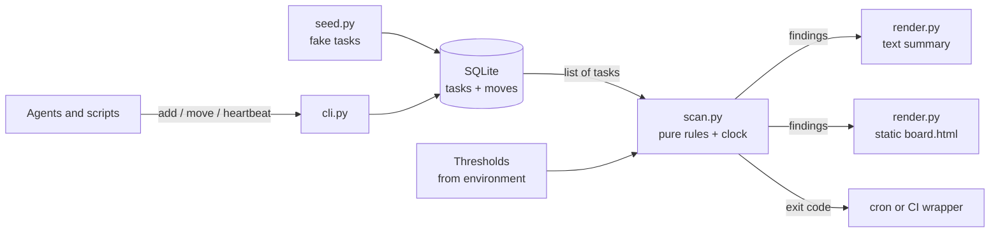

# stall-board

When a fleet of agents works in parallel, a task can sit untouched for a day and nobody notices, because every agent only sees its own queue.
The work that hurts most is the work parked on a person who does not know they are the bottleneck.

## What it does

`stall-board` is a small work in flight board. Agents (or the scripts that run them) record tasks in one SQLite file: an id, a title, an owner, a state and the time the task last moved. A scan then reads the board against the clock and raises three flags:

| Flag | Raised when | Escalates to alert |
| --- | --- | --- |
| `waiting_human` | the task is parked until a person answers (always flagged, with who) | after 4 hours |
| `blocked` | the task cannot move for a non human reason (always flagged, with why) | after 8 hours |
| `idle` | `in_progress` with no move for 6 hours, or `queued` and never started for 24 hours | `in_progress` after 18 hours |

The scan produces two outputs from the same result: a plain text summary for a terminal, chat message or cron mail, and a single static HTML file with one column per state. Moving a task to the state it is already in counts as a heartbeat and resets its clock. Every move is appended to a `moves` table, so the history of a task is never overwritten.

No dependencies beyond the Python standard library (3.10 or newer). No network calls, no API keys.

## Architecture



- `stall_board/db.py`: schema, `add_task`, `move_task`, move history.
- `stall_board/scan.py`: the rules. Pure functions of (tasks, now, thresholds), no I/O.
- `stall_board/render.py`: text summary and HTML board. All task text is HTML escaped.
- `stall_board/seed.py`: 14 invented tasks placed at fixed offsets before "now".
- `stall_board/cli.py`: `seed`, `add`, `move`, `list`, `scan`, `board`.

## Run it

```bash
python -m stall_board seed
python -m stall_board scan
python -m stall_board board --out board.html
```

Then open `board.html`. Day to day use looks like this:

```bash
python -m stall_board add T-200 "Draft the monthly report" --owner agent-ledger
python -m stall_board move T-200 in_progress
python -m stall_board move T-200 waiting_human --waiting-on "ops lead" --note "needs a yes or no"
python -m stall_board scan --fail-on alert   # exit 1 if any alert exists
```

Configuration is optional and comes from environment variables; see `.env.example`. `--db` picks the SQLite file and `--now` pins the clock for repeatable runs.

## Tests

```bash
python -m pip install -r requirements-dev.txt
python -m pytest -q
```

48 tests cover the storage layer, every scan rule at its threshold, both renderers (including HTML escaping) and the CLI end to end. CI (`.github/workflows/ci.yml`) runs them on Python 3.10 and 3.12 and also reruns the demo and diffs it against the captured output.

## Demo

```bash
python demo/run_demo.py
```

The demo runs offline with a pinned clock. It seeds the fake board, scans it, has a human approve one task and a stalled agent send a heartbeat, scans again and writes the HTML board. The captured output is in [`demo/output.txt`](demo/output.txt) and the board it wrote is in [`demo/board.html`](demo/board.html). A slice of the first scan:

```text
STALL BOARD  2026-01-15 12:00 UTC
14 tasks: 3 queued, 4 in_progress, 2 blocked, 3 waiting_human, 2 done
Flagged: 9 (4 alert, 5 warn)

WAITING ON A HUMAN (3)
  [ALERT] T-106  Approve refund above the auto limit (Sample... agent-ledger     waiting on bookkeeper for 26h
  [ALERT] T-107  Confirm scope change before sending revised... agent-quotes     waiting on ops lead for 7h
  [WARN ] T-105  Reschedule Thursday crew after cancellation    agent-scheduler  waiting on field supervisor for 1h
```

All tasks, owners and customers in the seed are invented.

## Where this pattern runs

This is drawn from systems that run two small service companies day to day, where several agents handle intake, quoting, scheduling and bookkeeping side by side. The lesson behind it: the expensive failures were rarely crashes. They were tasks that quietly stopped, most often while waiting on a person, so the board puts "waiting on a human" at the top of every summary.

## Limitations

- The board only knows what it is told. An agent that never records a move looks idle even if it is working, and one that sends heartbeats in a loop looks healthy even if it is stuck.
- "Last moved" is one timestamp per task. There is no measure of progress, only of activity.
- Thresholds are global. There are no per owner or per task overrides, no business hours and no time zones: 4 hours overnight counts the same as 4 hours at midday.
- Each task gets at most one flag, decided by its state.
- The HTML board is a snapshot. It does not refresh itself; rerun `board` (for example from cron) to update it.
- Nothing is sent anywhere. The scan sets an exit code and prints text; wiring that to chat or email is left to the caller.
- SQLite with one writer at a time is fine for a handful of agents on one machine. It is not a multi host queue, and there is no authentication on who may move a task.
- No dependencies between tasks, no priorities, no due dates.

License: MIT, see the LICENSE file.
