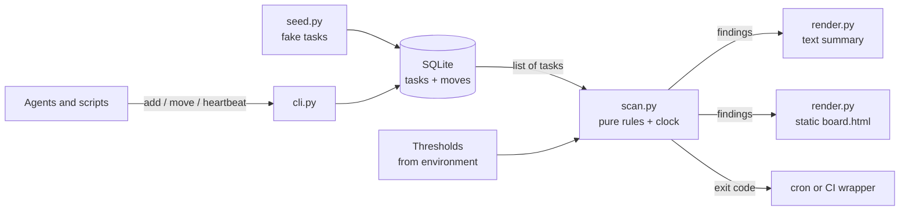

# stall-board

**Find the work your agents have quietly stopped doing, and the person each stuck task is waiting on.**

If you run several agents side by side, a task can sit untouched for a day and nobody notices, because each agent only sees its own queue. The costly case is the task parked on a person who does not know they are the bottleneck.

`stall-board` is one shared board for that work in flight. It is for an operator or developer running a handful of agents or scripts on one machine. Each agent records its tasks in one SQLite file. One command then reads the board against the clock and tells you:

- what is **waiting on a human**, who that human is and for how long
- what is **blocked**, and by what
- what is **idle**: claimed as in progress, or queued, with no activity

You get a plain text summary (for a terminal, a chat message or cron mail), a static HTML board, and an exit code a cron job can act on. It is Python standard library only: nothing to install, no network calls, no API keys.

## What you will see

Real output from the offline demo (`python demo/run_demo.py`, fake data, pinned clock). This is the first scan, copied from [`demo/output.txt`](demo/output.txt), which CI regenerates and diffs on every push:

```text
STALL BOARD  2026-01-15 12:00 UTC
14 tasks: 3 queued, 4 in_progress, 2 blocked, 3 waiting_human, 2 done
Flagged: 9 (4 alert, 5 warn)

WAITING ON A HUMAN (3)
  [ALERT] T-106  Approve refund above the auto limit (Sample... agent-ledger     waiting on bookkeeper for 26h
  [ALERT] T-107  Confirm scope change before sending revised... agent-quotes     waiting on ops lead for 7h
  [WARN ] T-105  Reschedule Thursday crew after cancellation    agent-scheduler  waiting on field supervisor for 1h

BLOCKED (2)
  [ALERT] T-109  Import supplier price sheet                    agent-quotes     blocked for 2d 4h: file arrived as a scanned image
  [WARN ] T-108  Sync calendar holds to the job tracker         agent-scheduler  blocked for 3h: tracker API returning 503
```

The demo then has the bookkeeper approve T-106 and a stalled agent send a heartbeat, and the second scan drops from 9 flags to 7. The HTML board it writes is [`demo/board.html`](demo/board.html). All tasks, owners and customers in the seed are invented.

## The rules

A task has an id, a title, an owner, a state (`queued`, `in_progress`, `blocked`, `waiting_human`, `done`) and two clocks: when it last moved and when it entered its current state.

| Flag | Raised when | Becomes an alert |
| --- | --- | --- |
| `waiting_human` | the task is parked until a person answers (always flagged, with who) | 4 hours after it was parked |
| `blocked` | the task cannot move for a non human reason (always flagged, with why) | 8 hours after it was blocked |
| `idle` | `in_progress` with no move for 6 hours, or `queued` and never started for 24 hours | `in_progress` at 3 times the idle limit (18 hours); `queued` stays a warning |

Moving a task to the state it is already in is a heartbeat. A heartbeat clears `idle`, because idle is timed from the last move. It does not shorten `waiting_human` or `blocked`, which are timed from when the task entered that state, so an agent that keeps checking in cannot hide how long a person has been asked. Every move is appended to a `moves` table, and normal use never rewrites it (only `seed --force` deletes history).

The 4, 8, 6 and 24 hour limits are defaults. Override them with environment variables; see `.env.example`.

## Run it

Needs Python 3.10 or newer. From the repo root, with no install step:

```bash
python -m stall_board seed
python -m stall_board scan
python -m stall_board board --out board.html
```

Then open `board.html`. `seed` loads 14 fake tasks into an empty board and refuses to touch a board that already has tasks unless you pass `--force`. Day to day use looks like this:

```bash
python -m stall_board add T-200 "Draft the monthly report" --owner agent-ledger
python -m stall_board move T-200 in_progress
python -m stall_board move T-200 waiting_human --waiting-on "ops lead" --note "needs a yes or no"
python -m stall_board scan --fail-on alert   # exit 1 if any alert exists
```

`--db` (or `STALL_BOARD_DB`) picks the SQLite file; the default is `stall_board.db` in the current folder. `--now` pins the clock for repeatable runs. `pip install .` also works and adds a `stall-board` command.

## Tests and demo

```bash
python -m pip install -r requirements-dev.txt
python -m pytest -q
python demo/run_demo.py
```

57 tests cover the storage layer, every scan rule at its threshold, both renderers (including HTML escaping) and the CLI end to end. The only test dependency is pytest. CI (`.github/workflows/ci.yml`) runs the tests on Python 3.10 and 3.12, installs the package, reruns the demo and diffs it against `demo/output.txt`.

The demo seeds the fake board, scans it, has a human approve one task and a stalled agent send a heartbeat, scans again and writes the HTML board.

## Architecture



- `stall_board/db.py`: schema, `add_task`, `move_task`, move history.
- `stall_board/scan.py`: the rules. Pure functions of (tasks, now, thresholds), no I/O.
- `stall_board/render.py`: text summary and HTML board. All task text is HTML escaped.
- `stall_board/seed.py`: 14 invented tasks placed at fixed offsets before "now".
- `stall_board/cli.py`: `seed`, `add`, `move`, `list`, `scan`, `board`.

## Where this pattern comes from

The design comes from running several agents side by side for small service businesses (intake, quoting, scheduling, bookkeeping). The lesson behind it: the expensive failures were rarely crashes. They were tasks that quietly stopped, most often while waiting on a person, so "waiting on a human" sits at the top of every summary.

This repository is a standalone demonstration of that pattern. Everything in it is exercised by its own tests and demo on fake data, and nothing more is claimed for it.

## Limitations

- **Nothing here is connected to a real agent framework.** There is no adapter for any agent runner, queue or task tracker. Agents (or their wrapper scripts) must call `add` and `move` themselves. The "agents" in the demo are seed rows and CLI calls, not running agents.
- **Nothing is sent anywhere.** The scan prints text and sets an exit code. The "cron wrapper would notify" line in the demo is a printed message; sending chat or email is left to the caller and has never been wired up or tested here.
- **It has only been run on fake data** with a pinned clock: the 14 seed tasks, the tests and the demo. It has not been load tested, and no timing or scale figures are claimed.
- The board only knows what it is told. An agent that never records a move looks idle even if it is working, and one that sends heartbeats in a loop never looks idle even if it is stuck.
- The clocks measure activity, not progress.
- Thresholds are global. There are no per owner or per task overrides, no business hours and no time zones: 4 hours overnight counts the same as 4 hours at midday.
- Each task gets at most one flag, decided by its state.
- The HTML board is a snapshot. It does not refresh itself; rerun `board` (for example from cron) to update it.
- SQLite on one machine with a handful of writers. Concurrent writers are not tested, it is not a multi host queue, and there is no authentication on who may move a task.
- No dependencies between tasks, no priorities, no due dates.

License: MIT, see the LICENSE file.
